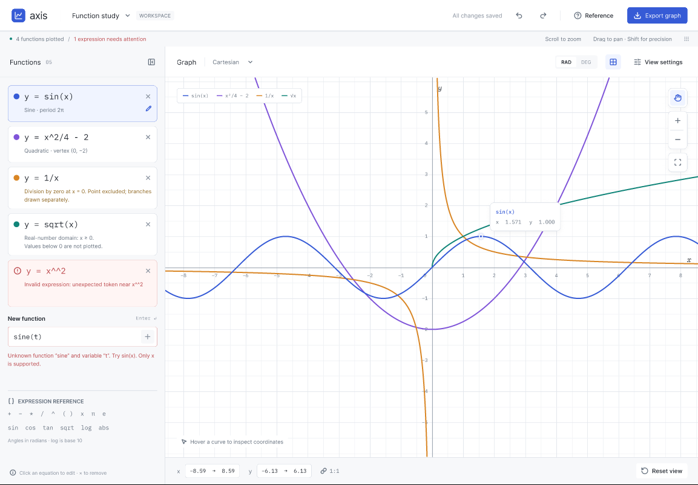

# Graphing App Requirements
## 1. Core Functional Requirements (MVP)
- Function input

The application should allow users to:

1.1 Enter mathematical functions, such as:
```
    y = x^2
    y = sin(x)
    y = 2*x + 5
```
- Edit an existing function.
- Remove a function.
- Display multiple functions on the same graph.
- Assign each function a distinguishable colour or line style.

1.2 Expression support

The expression parser should support:

    Basic arithmetic: +, -, *, /
    Powers: ^
    Parentheses
    Variables, initially at least x
    Common mathematical functions:
        sin, cos, tan
        sqrt
        log
        abs
    Mathematical constants such as π and e

1.3 Graph rendering

The application should:

- Draw X and Y axes.
- Display a coordinate grid.
- Plot functions accurately across the visible range.
- Automatically update the graph when a function changes.
- Handle discontinuities appropriately where possible, such as 1/x.

2. Graph Navigation

The user should be able to:

    Zoom in and out.
    Pan around the graph.
    Reset the view to a default position.
    See axis labels and scale values.
    Resize the application window without breaking the graph.

3. Error Handling

The application should provide useful feedback for:

    Invalid mathematical expressions.
    Unknown functions or variables.
    Division by zero.
    Invalid function domains, such as sqrt(-1) when working with real numbers.

Errors should not crash the application.

For example:

    Invalid expression: unexpected token near x^^2

4. User Interface

A basic interface could contain:

    Function list/sidebar — shows all entered equations.
    Input field — allows a new function to be entered.
    Graph area — displays the plotted functions.
    Graph controls — zoom, reset, and navigation options.


5. Important Technical Requirements

Since you're building this as a programming project, I'd also define some non-functional requirements:
Architecture

The project should separate:

    Expression parsing
    Mathematical evaluation
    Graph calculation
    Graph rendering
    User interface

This is particularly important if you're using C++, as it makes the individual components easier to test and develop independently.
Performance

The application should:

    Render graphs smoothly during zooming and panning.
    Avoid freezing when evaluating complex functions.
    Only calculate points needed for the currently visible graph area.

Testing

You could write tests for:

    Expression parsing.
    Operator precedence.
    Function evaluation.
    Invalid expressions.
    Edge cases such as division by zero.

6. Optional Features

Once the core application works, you could add:
Mathematical analysis

    Find roots/intercepts.
    Calculate derivatives.
    Calculate definite integrals.
    Find local minimum and maximum points.

More graph types

    Parametric equations.
    Polar graphs.
    Scatter plots.
    User-defined data points.

Quality-of-life features

    Save and load graphs.
    Export the graph as an image.
    Toggle grid and axes.
    Custom graph colours.
    Dark/light mode.

